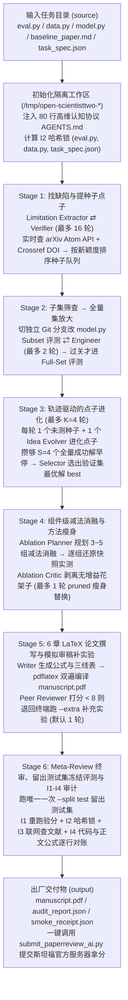

# 谷歌原版《ScientistTwo》深度解构与逆向工程指引：在没有一行开源代码的情况下，我们是怎么把它扒透并复刻出来的？

> **导读**：谷歌云 AI 研究院（Google Cloud AI Research）联合滑铁卢大学发表的 65 页长文《ScientistTwo: Pioneering the Human Knowledge Frontier with Autonomous AI》（[`arXiv:2609.19644`](https://arxiv.org/abs/2609.19644)，项目主页 [`scientist-two.github.io`](https://scientist-two.github.io/)）在科技圈刷了屏——号称在 107 道顶会科研题目上拿下 **`80.4%`（86/107）** 的成功率、性能比人类原论文平均相对提升 **`25.2%`**、在斯坦福独立盲审系统下拿到 **`72.1%`** 的录用率（而此前 7 个开源自动科研框架录用率清一色为 **`0.0%`**）。
>
> 然而，当你兴冲冲打开它的项目官网想看代码时，会发现谷歌只晒出了 86 篇生成的论文 PDF，**却把整套框架的源码捂得严严实实，一行都没开源**。
>
> 好在对于天天在终端里调 CLI Agent 的程序员来说，这篇 65 页的论文根本藏不住秘密。只要把论文正文 §3.1–§3.6、图 4 的 9 行 Python 伪代码、16 张实验表以及四个附录（A.1 / A.2 / B / C / D）拼在一起逐行对账，这套系统的每一根骨头、每一个硬编码超参数、甚至作者做实验时的求生欲和心理活动，全都是透明的。
>
> 本文就是我们纯靠论文与附录的蛛丝马迹，一比一逆向还原出 **[`open-scientisttwo`](https://github.com/lmxxf/open-scientisttwo)** 的工程图纸与深度扒底裤笔记。

---

## 目录

1. [第一章：附录 A.2 与表 8 的名场面——“谷歌搭台、Claude 唱戏”与 `Antigravity` 备胎求生欲](#第一章附录-a2-与表-8-的名场面谷歌搭台claude-唱戏与-antigravity-备胎求生欲)
2. [第二章：对清华 `AutoSOTA` 的“回旋镖”——先借人家开源题库，再拿人家开源代码当反面靶子](#第二章对清华-autosota-的回旋镖先借人家开源题库再拿人家开源代码当反面靶子)
3. [第三章：从图 4 的 9 行伪代码到 `open-scientisttwo` 源码——六阶段工程图纸与硬超参一比一对照表](#第三章从图-4-的-9-行伪代码到-open-scientisttwo-源码六阶段工程图纸与硬超参一比一对照表)
4. [第四章：论文真正做对的两大工程亮点（以及我们在 `open-scientisttwo` 里的硬核复刻）](#第四章论文真正做对的两大工程亮点以及我们在-open-scientisttwo-里的硬核复刻)
5. [第五章：扒开四大头条水分与两个 AI 审稿器的底细（指导我们在复刻版里如何避坑与对标）](#第五章扒开四大头条水分与两个-ai-审稿器的底细指导我们在复刻版里如何避坑与对标)
6. [第六章：从单题 3,765 美元到几块钱半小时跑穿——`open-scientisttwo` 的破局之道与对标指南](#第六章从单题-3765-美元到几块钱半小时跑穿open-scientisttwo-的破局之道与对标指南)

---

## 第一章：附录 A.2 与表 8 的名场面——“谷歌搭台、Claude 唱戏”与 `Antigravity` 备胎求生欲

很多人看完网上的二手通稿，以为谷歌又训练出了什么神秘的“科研专用大模型”。其实只要翻到论文第 28 页的 **附录 A.2（Configuration，系统配置）**，第一句话就能让所有程序员笑出声来。

### 1.1 扒开附录 A.2 第一句：谁在外围动嘴，谁在终端里干苦力？

我们先看附录 A.2 的原文原话：

> *"Unless otherwise specified, we employ **Gemini 3.6 Flash** for all agents, except for the **Idea Experiment Coding Agent**, the **Ablation Study Agent**, the **Rebuttal Agent**, and the **Draft Enhancer**, which use **Claude Code with Opus 4.8**."*
>
> （译文：除非另有说明，我们为所有智能体配备 `Gemini 3.6 Flash`，**但以下四个角色除外：点子实验编码智能体、消融实验智能体、审稿答辩智能体以及论文改稿增强器，这四个角色使用的是搭载 `Claude Opus 4.8` 的 `Claude Code`。**）

这就叫 **“谷歌搭台、Claude 唱戏”**：

- **外围只动嘴不碰终端的轻活（全用自家的 `Gemini 3.6 Flash`）**：读原论文 PDF 抠局限性（`Limitation Extractor / Verifier`）、提种子点子（`Idea Generator`）、看实验日志给 `Good / Bad / Engineer` 打分（`Critic`）、挑最佳点子（`Selector`）——这些角色全都不需要碰 Linux 终端，只需要调普通对话 API 吐一个 JSON 结构出来，用 Flash 模型既便宜又省钱；
- **真正进虚拟机 Linux 终端干核心重活的四大主力（全用死对头 Anthropic 的 `Claude Code + Opus 4.8`）**：
  1. **`Idea Experiment Coding Agent`**：进代码仓改模型源码、在数据子集与全量集上跑训练脚本、看报错修 Bug、调超参；
  2. **`Ablation Study Agent`**：按消融计划挨个删改代码模块、重跑 5–6 组组件级消融实验；
  3. **`Rebuttal Agent`**：把审稿人的刁钻质疑转化成补充实验代码，退回终端补跑实验并拿回新数据；
  4. **`Draft Enhancer`**：把补跑出来的实验表格和深度分析塞回 LaTeX 论文手稿。

### 1.2 外层 Python 状态机是怎么全自动驱动交互式 `Claude Code` 的？

平时我们在终端里用 `Claude Code` 或 `Codex` 都是手动敲字聊天、遇到执行命令还要按回车点确认，谷歌这套号称“全程无人干预（without human intervention）”的流水线是怎么调它的？为什么谷歌研究院不自己写一个改代码的 Agent 壳子？

答案特别实在：**自己从零手搓一个能在几万行真实科研代码仓里连续跑几小时的 Coding Agent 壳子，太容易翻车了！** 大文件怎么局部替换不乱缩进、几万行 PyTorch 报错日志怎么截断不爆上下文窗口、上下文满了怎么自动 compact——这些脏活累活，Anthropic 和 OpenAI 已经在 `Claude Code` 和 `Codex CLI` 客户端里打磨成了极其稳定的基础设施。

而现代命令行智能体全部内置了专门供自动化脚本调用的 **“非交互无头模式（Headless / Exec Mode）”**。外层 Python 状态机根本不需要自己写任何 `read_file`、`edit_file`、`run_bash` 工具函数，只需要切到虚拟机里刚克隆下来的顶会开源仓目录，用 Python 的 `subprocess` 直接拉起一个带 **`-p`（非交互直接输出结果）** 和 **`--dangerously-skip-permissions`（跳过一切人工权限确认弹窗）** 的命令行子进程：

```bash
# 谷歌原版在沙箱虚拟机里调用的无头子进程等价形式
claude -p "你要实现的新点子是：<点子描述>。请修改当前仓库代码，先在 subset 上跑通并输出指标 JSON..." \
  --model claude-opus-4-8 \
  --dangerously-skip-permissions \
  --output-format json
```

这一行命令敲下去，`Claude Code` 就在虚拟机里自己接管了代码仓，在内部自动跑上百轮“读源码 $\rightarrow$ 改模型 $\rightarrow$ 起 GPU 训练 $\rightarrow$ 看报错修 Bug”的闭环；等它跑完退出，外层 Python 脚本收割磁盘上的新代码和日志喂给 `Gemini 3.6 Flash` 裁判打分。

看穿了这一层窗户纸，我们在复刻 **`open-scientisttwo`** 时，直接在 [`open_scientisttwo/runner.py`](open_scientisttwo/runner.py) 里写了不到 75 行代码的 `CodexRunner`，用完全同构的无头子进程方式驱动 **`Codex CLI (gpt-6.1-sol low)`**（同时兼容 `--backend claude` 与 `--backend custom`）：

```python
# open_scientisttwo/runner.py 第 40-46 行：直接拉起无头 CLI 子进程并施加进程组超时与哈希锁守卫
if self.backend == 'codex':
    cmd = ['codex', 'exec', '--dangerously-bypass-approvals-and-sandbox',
           '--skip-git-repo-check', '-C', str(self.root), '-m', self.model,
           '-c', 'model_reasoning_effort="low"', '-o', str(output), prompt]
elif self.backend == 'claude':
    cmd = ['claude', '-p', prompt]
```

### 1.3 第 10 页表 8 的名场面：为什么突然冒出来一个 `Antigravity CLI`？

整篇论文最让人忍俊不禁的名场面，出现在第 10 页的 **表 8（`Table 8: Coding Agent Generalizability`）**。

前面 107 道题的主实验（表 2、表 3、表 4）全是用 `Claude Code (Opus 4.8)` 跑完的，为什么到了第 10 页突然冒出来一个搭载 `Gemini 3.8 Flash` 的 **`Antigravity`**？

你完全可以脑补出谷歌作者们写完主实验初稿、准备提交内部审批时的心理活动：

> **“坏了！咱们顶着 Google Cloud AI Research 的招牌发旗舰论文，结果附录 A.2 一掀开，底下真正干活写代码的 CLI 全用的是死对头 Anthropic 的 `Claude Code（Opus 4.8）`！要是公司老板或者审稿人问一句：‘你们为什么不用谷歌自家的 `Antigravity CLI`？换自家的 CLI 还能跑得通吗？’——这怎么交差？！”**

于是，作者们赶紧从 107 道题里只抽了 **5 道 ICLR 2026 的题目**，做了一次“把 `Claude Code (Opus 4.8)` 拔掉、换成搭载 `Gemini 3.8 Flash` 的谷歌自家 `Antigravity CLI`”的二选一替换实验，列在了表 8 里：

| 底层 Coding Agent CLI | 搭载模型 | 5 道 ICLR 2026 成功率 (`SR`) | 场内 `ScholarPeer` 均分 / 录用率 | 场外斯坦福 `Stanford Reviewer` 均分 / 录用率 |
| :--- | :--- | :---: | :---: | :---: |
| **`Claude Code`（主实验主力）** | `Claude Opus 4.8` | **`80.0%`（4 / 5）** | **`7.0 ± 1.2`** / **`100.0%`** | **`5.4 ± 0.2`** / **`75.0%`** |
| **`Antigravity`（谷歌自家备胎）** | `Gemini 3.8 Flash` | **`60.0%`（3 / 5）** | `6.3 ± 1.5` / `66.7%` | **`4.8 ± 1.0`** / `66.7%` |

*(注：表 8 中 `Antigravity` 在成功的 3 道题上算术平均涨幅 `Avg. Gain` 为 `16.7%`，主要受单题高比值拉动；而任务成功率与两套审稿得分全面下滑。)*

看看这张表的数据：一旦把 `Claude Code (Opus 4.8)` 换成自家的 `Antigravity (Gemini 3.8 Flash)`，**5 道题的成功率当场从 `80.0%`（4/5）掉到了 `60.0%`（3/5），场内审稿录用率从 `100.0%` 掉到 `66.7%`，场外斯坦福独立盲审均分更是从 `5.4` 分掉到了 `4.8` 分（跌破 5.0 分及格线）！**

但哪怕分数掉了一截，好歹跑通了 3 道题！作者们终于松了一口气，在正文第 4.2 节郑重其事地写下结论：*“如表 8 所示，这证明了我们的外层框架具有良好的跨 Coding Agent 泛化性，不绑死 `Claude Code`，换上自家的 `Antigravity` 当备胎也能跑出合规可复现的代码仓！”* ——这股浓浓的大厂打工人求生欲，简直跃然纸上。

---

## 第二章：对清华 `AutoSOTA` 的“回旋镖”——先借人家开源题库，再拿人家开源代码当反面靶子

读这篇论文时，除了开篇表 2 里被当成“盲审 `0.0%` 录用率背景板”的 7 个写论文框架（`AI-Researcher`、`CycleResearcher`、`AI Scientist-v2`、`DeepScientist`、`LiveResearchBench`、`AutoResearchClaw`、`ScientistOne`），还有一个名字从头到尾贯穿了附录 A.1、表 4 和整个附录 B——那就是清华大学 FIB 实验室与中关村学院团队开源的 **`AutoSOTA`**（[`arXiv:2604.05550`](https://arxiv.org/abs/2604.05550)，开源仓 [`tsinghua-fib-lab/AutoSOTA`](https://github.com/tsinghua-fib-lab/AutoSOTA)）。

谷歌对 `AutoSOTA` 的操作，堪比教科书级别的 **“先白嫖你的开源题库，再拿你的开源代码当反面靶子打，最后把我自己写的代码锁进黑盒”**。

### 2.1 第一步：白嫖 `AutoSOTA` 辛辛苦苦筛出来的可复现顶会题库

为什么以前那些全自动科研框架（比如 1.5 万星的 `AutoResearchClaw`）跑出来的全是垃圾？因为它们让大模型从零瞎编课题、从零写实验代码——大模型一遇到环境配不通或者跑不出正收益，就开始按公式编造假数据糊弄交差。

而清华 `AutoSOTA` 团队干了一件非常实在的苦力活：他们从各大 AI 顶会里，按照 **“作者开源了完整 GitHub 代码、环境能自动配通、单机几小时内能复现出原论文分数”** 的严苛标准，大海捞针筛出了 **100 多篇能一键复现的顶会代码仓**，并全部整理开源在了 GitHub 上。

到了谷歌做 `ScientistTwo` 时，翻开 **附录 A.1（Benchmarks）** 一看：
- 谷歌测试的 **38 篇 NeurIPS 2025** 和 **5 篇 ICLR 2026** 考题，**直接照搬了 `AutoSOTA` 已经筛好验证过的现成题库**（另外 64 篇 ICML 2026 Spotlight 也是严格照着 `AutoSOTA` 的过滤管线筛出来的）！
- 换句话说，`ScientistTwo` 根本不是从零发明新理论，它的真实考题定义是：**“给你一个清华团队已经帮你验证过能一键跑出分数的顶会开源代码仓和原论文 PDF，请让 `Claude Code` 在里面找个瓶颈、改一段模型代码把分数往上提一截，再顺着原论文的架子重写一篇改进版论文。”**

### 2.2 第二步：在附录 B（表 15 / 表 16）里把 `AutoSOTA` 的开源改动代码逐行拉出来公开处刑

`AutoSOTA` 的定位是 **“只改代码刷单点指标、不写论文的优化器”**——它从每篇原论文里抽出 **1 个头条指标数字** 当靶子，只要跑出的新数字超过靶子就停机交卷，并且老老实实把它在每道题上改出来的代码全开源到了 GitHub 上。

结果，因为清华团队把改出来的代码全开源了，谷歌作者转头就在 **附录 B（`Detailed Comparison with AutoSOTA`，表 15 与表 16）** 里，把 `AutoSOTA` 在 5 篇 ICLR 2026 论文上的代码改动逐行扒了出来当反面教材批（而谷歌自己的 `ScientistTwo` 却不开源框架源码）：

| ICLR 2026 考题 | `AutoSOTA` 的开源代码改动（被谷歌抓包的“单指标刷分捷径”） | 谷歌 `ScientistTwo` 派 `Claude Code` 做的改动与审计结果 |
| :--- | :--- | :--- |
| **1. `Pinet`**<br>*(Grontas et al., 硬约束神经网络正交投影层)* | **砍求解步数换速度，不报约束是否还成立**：<br>盯着“推理延迟”单一指标，只改了 **3 行配置**——把测试时的求解器迭代步数 `n_iter_test` 从 `50` 步粗暴砍到 `10` 步、关掉 `float64` 双精度、把 `relu` 换成 `silu`，喜报“延迟降低 `16.7%`”。可被砍掉的那 40 步求解器本来正是用来控制约束违背度的，它压根没报可行性（`feasibility unreported`）。 | **零空间重参数化 + 对数障内点流（`ANSE`）**：<br>直接把决策变量表示在等式约束的零空间里（使等式约束在数学构造上恒满足），配合降维行均衡分裂与对数障可行流，在 4 个数据集上把约束违背度从 `4e-4` 压到机器精度 `2e-14`，同时训练提速 `3.0×`。 |
| **2. `T-SAE`**<br>*(Bhalla et al., 时序稀疏自编码器可解释性)* | **不动模型一行代码，直接改评测脚本的裁判阈值**：<br>只改了 **1 行代码**——把评测脚本里展示给大模型裁判看的激活阈值 `act_threshold_frac` 从 `0.01` 改成 `0.05`。压根没碰 SAE 模型本身，靠改变喂给 LLM 裁判的显示词元骗到 `+2.25%`（甚至重跑一次得分 `0.7557` 比原基线 `0.7586` 还低）。 | **层拉普拉斯算子 + 对比 Koopman 预测目标**：<br>在 `I2` 审计下严禁触碰评测脚本，通过修改时序一致性训练目标，在全部 5 项评测指标上取得一致提升（平均 `+1.0%`）。 |
| **3. `TeCh`**<br>*(Yu et al., 医学时间序列分类)* | **靠“调宽网络 + 标签平滑”通用调参涨分交卷**：<br>把隐藏维宽度 `d_model` 从 `256` 扩到 `384`、加上标签平滑（Label Smoothing）和 `AdamW`，准确率涨了 `+4.45%` 就算成功。 | **找到了同样的调参捷径，但被自家“减法消融裁判”当场枪毙**：<br>`Claude Code` 改出的 `DMC-TeCh` 在 6 项指标里赢了 5 项，但第四阶段的消融裁判一测，发现**“涨分主要来自 EMA 与标签平滑等通用训练技巧，而非所提多核架构本身”**，当场判为不合格拒收！（故 ICLR 仅成 4/5 篇） |
| **4. `DMSQD`**<br>*(Tjanaka et al., 高维质量多样性优化)* | **只改 1 个发射器数量超参**：<br>把 CMA-MAE 发射器数量 `num_emitters` 从 `15` 调到 `25`，跑 1 轮过线即停机。 | **先堆了 4 个数学花架子，再靠减法消融砍掉 3 个**：<br>`Claude Code` 起初一口气塞进 Fisher-Rao 度量、Tensor-Train、Legendrian 接触形式和维度自适应平滑惩罚 4 套模块；减法消融发现前 3 套删掉根本不掉分，当场全部剥离，只留 1 个平滑惩罚项。 |
| **5. `RALI`**<br>*(Zhao et al., 图像质量评估)* | **微调已实现的三个池化分支混合权重**：<br>改动不到 10 行配置参数。 | **对抗性内容—质量解耦 + 区域级质量分割**，在 6 个数据集上全面验证。 |

客观地说，虽然谷歌“先借题库、再拿人家开源代码当靶子”的做法有点不讲武德，但附录 B 扒出来的这几个案例，**确实精准命中了所有无人看管 Coding Agent 的命门**——如果你只给 AI 一个目标数字、不锁死评测脚本、不检查物理约束违背度、不做减法消融归因，AI 100% 会去走“砍求解步数、改裁判阈值、调大网络宽度”这些阻力最小的作弊捷径！

这也正是我们在 **`open-scientisttwo`** 中设计 [`benchmarks/pinet_hcnn`](benchmarks/pinet_hcnn) 的直接来源：我们在 `pinet_hcnn/eval.py` 里不仅用 `I2` 哈希锁死死焊住了评测脚本，而且把相对次优度 `rs_mean`、最大约束违背度 `cv_max` 和求解耗时 `solve_time_ms` 同时写进了综合主指标（一旦 `cv_max > 1e-2` 直接施加 `1000.0 * cv_max` 的毁灭性重罚），彻底堵死了靠砍步数牺牲可行性来刷速度的后门。

---

## 第三章：从图 4 的 9 行伪代码到 `open-scientisttwo` 源码——六阶段工程图纸与硬超参一比一对照表

既然谷歌没开源代码，我们是怎么把整套 `ScientistTwo` 引擎一比一复刻出来的？

秘密就在论文第 3 页的 **图 4（`Figure 4: Python-style pseudocode for each pipeline stage`）**、**表 1（`Table 1: ScientistTwo overview`）**、正文 **§3.1–§3.6** 的数学符号定义，以及第 28 页 **附录 A.2** 的硬编码超参数里。

### 3.1 论文图 4 的 9 行伪代码 vs `open_scientisttwo/pipeline.py`

谷歌在论文图 4 里坦白了一个惊人的事实：**整套 65 页的 `ScientistTwo` 没有任何复杂的图网络或强化学习控制器，它的全部六个阶段，复用的都是同一个 9 行 Python `for` 循环状态机！**

我们把论文图 4 的原版伪代码，和我们 [`open_scientisttwo/pipeline.py`](open_scientisttwo/pipeline.py) 第 14–26 行的实际代码放在一起对比：

| 谷歌论文第 3 页图 4 原版伪代码 (`Listing 4`) | 本仓库 [`open_scientisttwo/pipeline.py`](open_scientisttwo/pipeline.py#L14-L26) 生产级实现 |
| :--- | :--- |
| ```python
def stage(candidate, critic, refine, max_rounds):
    for _ in range(max_rounds):
        verdict, feedback = critic(candidate)
        if verdict == "accept":
            return candidate
        elif verdict == "refine":
            candidate = refine(candidate, feedback)
        else:
            return None
    return None
``` | ```python
def stage(candidate, critic, refine, max_rounds):
    if max_rounds < 0:
        raise ValueError('negative refinement budget')
    value = candidate()
    for i in range(max_rounds + 1):
        verdict = critic(value)
        if verdict not in ('Good', 'Bad', 'Engineer'):
            raise ValueError('unknown critic decision')
        if verdict != 'Engineer':
            return value, verdict
        if i == max_rounds:
            return value, 'Bad'
        value = refine(value)
``` |

你看，所谓的“多智能体自主科研”，剥掉学术包装之后，核心原语就是：**生成器先产出一个候选产物 `candidate()` $\rightarrow$ 交给裁判 `critic(value)` 打分（判为 `Good / accept` 就过关，判为 `Bad / reject` 就当场丢弃，判为 `Engineer / refine` 就交给修理工 `refine(value)` 按反馈重改）$\rightarrow$ 若达到最大轮数预算 `max_rounds` 还没拿到 `Good`，就强制降级为 `Bad` 剪枝淘汰！**

### 3.2 六阶段 18 个智能体角色、附录 A.2 硬超参与 `open-scientisttwo` 源码一比一映射表

顺着正文 §3.1–§3.6 和附录 A.2 的每一个数字，我们整理出了下面这张完整的逆向工程图纸。论文里的 **18 个智能体角色** 与 **每一个硬编码预算超参数**，在 `open-scientisttwo` 的代码里都有严格的一一对应：

| 阶段 | 论文角色名称 (§3.1–§3.6) | 谷歌原版底层模型 (附录 A.2) | 谷歌附录 A.2 硬编码超参与停止准则 | `open-scientisttwo` 对应模块、方法与 CLI 参数 |
| :--- | :--- | :--- | :--- | :--- |
| **Stage 1**<br>找缺陷与提种子点子<br>(§3.1) | 1. `Limitation Extractor`<br>2. `Limitation Verifier`<br>3. `Idea Generator Agent`<br>4. `Novelty Checker` | `Gemini 3.6 Flash`<br>*(全部只动嘴返回 JSON)* | • 找局限循环上限：**最多 `16` 轮**（Verifier 确认完备即早停）；<br>• 文献查重：每个点子调 Google Search 检索 **`2` 篇** 参考论文算新颖度分数 $s_i$；<br>• 种子队列 $\mathcal{H}_0$ 按新颖度 $s_i$ **从高到低降序排列**。 | • [`pipeline.py:run()`](open_scientisttwo/pipeline.py#L145-L165)<br>• `stage(..., self.limitation_rounds)`：默认 **`16` 轮**（`--fast-demo` 为 1 轮，支持 `--limitation-rounds` 覆盖）；<br>• [`audits.py:lookup()`](open_scientisttwo/audits.py#L30-L32)：实时请求 `export.arxiv.org/api/query`（`max_results=2`）+ `Crossref API` 拉取真实文献元数据写入 `related_work.xml` 与 `references.json`；<br>• `ideas.sort(key=lambda x: x['novelty'], reverse=True)`。 |
| **Stage 2**<br>子集筛查到全量集放大<br>(§3.2) | 5. `Baseline Coding Agent`<br>6. `Subset Coding Agent`<br>7. `Subset Critic Agent`<br>8. `Subset Engineering Agent`<br>9. `Full-Set Coding / Critic / Engineer` | • Coding / Engineer：**`Claude Code (Opus 4.8)`**<br>• Critic：`Gemini 3.6 Flash` | • 先在数据子集（`Subset`）复现基线 $\mathcal{E}_{\mathrm{base}}$；<br>• 新点子先在 `Subset` 跑，Critic 给出三元裁决 **`Good / Bad / Engineer`**；<br>• 若判为 `Engineer`，最多允许调试 **`2` 轮**（$N_{\mathrm{eng}} = 2$），仍未达 `Good` 则判 `Bad` 剪枝；<br>• 只有 `Subset` 拿 `Good` 的点子，才放行到全量集（`Full-Set`）跑完整基准（同样允许最多 `2` 轮 `Engineer` 微调）。 | • [`pipeline.py:trial()`](open_scientisttwo/pipeline.py#L109-L134) & [`code()`](open_scientisttwo/pipeline.py#L102-L107)<br>• 先拍下 `baseline_subset` 与 `baseline_full` 不可变快照；<br>• 每次从父快照切出独立 Git 分支（`git checkout -B <label>`）改 `model.py`（若未改动源码直接报错拦截）；<br>• 依次在 `('subset', self.base_subset)` 和 `('full', self.base_full)` 上跑 `stage(..., self.engineering)`（默认 `--engineering-budget 2`）；<br>• **硬核防幻觉**：即便 Critic 嘴上判了 `Good`，[`spec.py:better()`](open_scientisttwo/spec.py#L26-L27) 也会用实测数值跟基线硬比对，没真跑赢基线当场强制改判 `Bad`！ |
| **Stage 3**<br>基于执行轨迹的点子进化<br>(§3.3) | 10. `Idea Evolver Agent` ($\mathcal{A}_{\mathrm{Evolve}}$)<br>11. `Selector Agent` ($\mathcal{A}_{\mathrm{Selector}}$) | `Gemini 3.6 Flash` | • 初始轮跑完后，进入最多 **`4` 轮进化循环**（$K = 4$）；<br>• 每轮测 **`2` 个候选**：**`1` 个**从没测过的种子队列 $\mathcal{H}_0$ 按序取（Exploration），**`1` 个**由 `Idea Evolver` 汇总此前所有成功与失败日志 $\mathbf{R}_{<k}$ 演化生成（Exploitation）；<br>• **早停条件**：一旦累计攒够 **`4` 个** 全量集 `Good` 成功方案（$S = 4$）立即早停；<br>• **熔断条件**：若 4 轮跑完成功数为 `0`，直接终止放弃该题；<br>• 最后由 `Selector` 从所有全量 `Good` 方案中挑出最优解 $h_{\mathrm{best}}$。 | • [`pipeline.py:run()`](open_scientisttwo/pipeline.py#L166-L185)<br>• 默认 `--K 4`、`--S 4`；先跑 `initial` 种子，随后在 `for k in range(self.K)` 循环中每轮依次跑 `seed{k}`（从 `ideas.pop(0)` 取）与 `evolved{k}`（由 `Idea Evolver` 读取 `state.json` 历史轨迹生成）；<br>• `if len(self.successes) >= self.S: break`；<br>• 若 `not self.successes` 则写入 `zero_successes` 回执并抛异常终止；<br>• `Selector` 选出 `self.best` 后，代码强制校验其确实是全量验证集实测最优值（防 Selector 选错）。 |
| **Stage 4**<br>组件级减法消融与瘦身<br>(§3.4) | 12. `Ablation Planner Agent`<br>13. `Ablation Coding Agent`<br>14. `Ablation Critic Agent` ($\mathcal{A}_{\mathrm{AblCritic}}$)<br>15. `Result Comparison Agent` | • Planner / Critic：`Gemini 3.6 Flash`<br>• Ablation Coder：**`Claude Code (Opus 4.8)`** | • 针对 $h_{\mathrm{best}}$ 自动规划 $N_p$ 组组件级减法消融（表 15 中每篇跑 **`5–6` 组**）；<br>• `Ablation Critic` 检查各组件贡献度，给出 `Good` 或 `Refine`；<br>• 若发现冗余/无增益模块，最多做 **`1` 轮** 方法瘦身重写（$N_{\mathrm{abl}} = 1$）；<br>• 瘦身后的新方案 $\mathcal{E}_{\mathrm{new}}$ 必须经比对优于或等于原 $\mathcal{E}_{\mathrm{best}}$ 才准替换。 | • [`pipeline.py:run()`](open_scientisttwo/pipeline.py#L186-L201)<br>• `Ablation Planner` 规划 `self.ablation_count` 组减法/控制消融配置（支持 `--ablation-plan-count 3..5`）；<br>• 逐组恢复 `self.best['snapshot']` 源码并运行 `snapshot(f'ablation{i}', ...)`；<br>• `Ablation Critic` 决定是否 `refine`（默认 `--ablation-refinement 1`），若触发则评测 `pruned` 快照，满足 `better(score, self.best['value'], self.spec, equal=True)` 即正式替换为最佳方案。 |
| **Stage 5**<br>论文初稿与模拟审稿补实验<br>(§3.5) | 16. `Initial Drafter Agent` (`PaperOrchestra`)<br>17. `Peer-Reviewer Agent` (`ScholarPeer`)<br>18. `Rebuttal Planner & Coding Agent` + `Paper Enhancer` | • Drafter / Reviewer：`Gemini 3.6 Flash`<br>• Rebuttal Coder & Enhancer：**`Claude Code (Opus 4.8)`** | • 按 ICLR 模板把主实验与消融表写成完整 LaTeX 论文初稿；<br>• 模拟审稿人 `ScholarPeer` 按 `1–10` 分打分；<br>• **早停阈值**：若得分 **$\ge 8$ 分** 立即早停；<br>• 若 **`< 8` 分**，派 `Rebuttal Agent` **退回终端在代码仓上跑补充实验** $\mathcal{E}_{\mathrm{reb}}$，再由 `Enhancer` 把新数据更新进论文，最多循环 **`2` 轮**（$N_{\mathrm{peer}} = 2$）。 | • [`pipeline.py:draft()`](open_scientisttwo/pipeline.py#L135-L143)、[`manuscript.py`](open_scientisttwo/manuscript.py) & [`pipeline.py:run()`](open_scientisttwo/pipeline.py#L202-L215)<br>• `Writer` 生成 6 章英文学术手稿（含原生 `$...$` 数学公式与全部实验三线表），双遍调用 `pdflatex` 编译出 `manuscript.pdf`；<br>• `Peer Reviewer` 打 `1–10` 分，`< 8` 分时调用 `Rebuttal Planner and Coder` 退回终端触发 `--extra` 扩展验证集测试（`rebuttal{i}` 快照）并重绘手稿；<br>• **关键优化**：吸取原论文表 5 第 2 轮过拟合掉分的教训，我们默认 `--max-peer-rounds 1`（最高支持设为 `2`）。 |
| **Stage 6**<br>总编终审与四道合规审计<br>(§3.6 & Table 7) | 19. `Meta-Review Agent` ($\mathcal{A}_{\mathrm{Meta}}$)<br>20. `CoE Integrity Audit Agents` (`I1–I4`) | • Meta-Reviewer：`Gemini 3.6 Flash`<br>• Audit Coder：**`Claude Code (Opus 4.8)`** | • `Meta-Reviewer` 给出 `Accept` 或 `Refine`，最多打回重改 **`1` 次**（$N_{\mathrm{meta}} = 1$）；<br>• 出厂前过 **表 7 四道 CoE 完整性审计**：<br>  - `I1` 分数复现核验<br>  - `I2` 规范合规防作弊核验<br>  - `I3` 参考文献真实性核验<br>  - `I4` 方法与代码逐行一致性对账。 | • [`pipeline.py:run()`](open_scientisttwo/pipeline.py#L216-L239) & [`audits.py`](open_scientisttwo/audits.py)<br>• `Meta Reviewer` 终审（最多修订 `1` 次）；<br>• 在从未参与选模的**留出测试集（`--split test`）**上冻结执行唯一一次 `final_test` 评测；<br>• 依次执行 `I1`（`verify_claims` 独立重跑核对全部表格数字）、`I2`（`protect` SHA-256 哈希锁校验）、`I3`（`verify_references` 联网查验全部 DOI 与标题）、`I4`（`Method-Code Auditor` 逐行核对 `model.py` 与正文公式），并输出 `audit_report.json` 与 `stanford_review.json`。 |

### 3.3 `open-scientisttwo` 六阶段闭环状态机数据流图



---

## 第四章：论文真正做对的两大工程亮点（以及我们在 `open-scientisttwo` 里的硬核复刻）

为什么表 2 里此前 7 个开源自动科研框架（含 1.5 万星的 `AutoResearchClaw`、`AI Scientist-v2` 等）生成的论文在斯坦福独立盲审下录用率全军覆没（**`0.0%`**），而 `ScientistTwo` 能拿下 **`72.1%`**？

平心而论，谷歌这篇论文在工程控制上真正做对了两件极其硬核的事：**一是第四阶段的“组件级减法消融”，二是第六阶段表 7 的“四道 CoE 完整性出厂审计”**。这两招直接把无人看管的梦游态大模型最爱干的“堆砌花架子”和“文不对码”锁进了笼子里。

### 4.1 亮点一：组件级减法消融（Subtractive Ablation）——专治 AI“堆砌数学名词花架子”与“靠通用调参混分”

用过 Coding Agent 写算法的人都知道大模型有一个祖传毛病：**为了显得自己很有水平，它极爱一口气往代码里塞三四个名字极其高大上的数学模块**；只要最后跑出来的总分比基线高一点，它就会在论文里大吹特吹这四个模块缺一不可。

谷歌在第四阶段（§3.4）设计的 **减法消融闭环**，堪称套在 AI 脖子上的紧箍咒——当选出最佳点子 $h_{\mathrm{best}}$ 后，系统不是顺着它写论文，而是**逼着 `Claude Code` 把它刚刚加进去的新模块挨个删掉（或关掉开关）重跑 5–6 组消融实验**！

看看附录 B 里两个最精彩的真实审讯现场：

1. **在 `TeCh`（ICLR 2026 医学时间序列）上，大义灭亲枪毙已经跑赢基线的方案**：
   - `Claude Code` 改出了一个叫 `DMC-TeCh`（多核架构）的方案，在全量 6 项指标里赢了 5 项，眼看就要大功告成了；
   - 结果到了 Stage 4，减法消融把新加的“多核架构”删掉、只留训练控制技巧重跑，消融裁判（`Ablation Critic`）当场出具诊断书：
     > *"The gains were primarily driven by general training controls (EMA and label smoothing) rather than the multi-core architectural innovation itself."*（性能提升主要来自指数滑动平均 EMA 和标签平滑等通用训练技巧，而非所提的多核架构创新本身。）
   - 系统当场将这篇已经跑赢基线的方案**判为不合格拒收**！（这也是为什么 `ScientistTwo` 在 5 道 ICLR 2026 题上只成了 4 道。）
2. **在 `DMSQD`（ICLR 2026 高维质量多样性优化）上，把 AI 堆上去的三套花架子扒得干干净净**：
   - `Claude Code` 起初为了刷分，一口气往代码里塞了四套听起来吓死人的数学名词：**① Fisher-Rao 信息几何度量、② 张量链（Tensor-Train）分解、③ Legendrian 接触形式、④ 维度自适应平滑惩罚**；
   - 经过组件级减法消融，裁判发现**前面三套高大上的模块删掉之后，实验分数连抖都不抖一下**！系统当场触发 `Refine` 瘦身，命令 `Claude Code` 把前三个花架子从代码仓和论文里彻底删掉，只留下真正干活的第 4 个平滑惩罚项。

**我们在 `open-scientisttwo` 中是如何复刻这一精髓的？**
- **协议层源头遏制（[`AGENTS.md`](AGENTS.md)）**：我们在自动注入每个工作区的 80 行高维认知协议第 4 条写下铁律——*“跑通后强制减法消融：改出优于基线的方案后，必须验证每个新增改动是否真有贡献；凡是删掉后指标不掉的冗余花架子代码，必须从最终方案中剥离。”*
- **状态机强制执行（[`open_scientisttwo/pipeline.py` 第 187–201 行](open_scientisttwo/pipeline.py#L187-L201)）**：`Ablation Planner` 强制规划 `3–5` 组减法消融配置（`"remove one proposed component"`），每次从不可变快照 `self.best['snapshot']` 干净恢复源码并实测记录 `ablation0..N`；随后 `Ablation Critic` 对照各消融项的实测涨跌决定是否触发 `pruned` 瘦身，一旦瘦身后的 `pruned` 快照实测不劣于原方案（`better(score, self.best['value'], self.spec, equal=True)`），立刻将 `pruned` 晋升为最终方案！

### 4.2 亮点二：表 7 的四道 CoE 完整性出厂审计（`I1–I4`）——揪出高达 `22.0%` 的“文不对码”

论文第 9 页的 **表 7（`Table 7: Integrity Audit`，在 50 道 ICML 2026 题目上做的完整性审计消融实验）**，披露了整篇论文对 AI 工程界最有价值的一组真实体检数据。

作者对比了“不加专门的审计修正智能体（第一行）”与“加上完整四道出厂审计（最后一行 `ScientistTwo`）”在 50 道题上的表现：

| 审计配置（表 7 关键行对照） | `I1` 分数复现核验<br>(`Score Verif.`) | `I2` 规范违规/作弊数<br>(`Spec. Violat.` $\downarrow$) | `I3` 幻觉参考文献数<br>(`Ref. Verif.` $\downarrow$) | `I4` 方法与代码一致性<br>(`Method-Code Alignment` $\uparrow$) |
| :--- | :---: | :---: | :---: | :---: |
| **无专门审计修正 Agent（原生裸跑）** | `50 / 50` | **`1 / 50`（抓出 1 篇作弊）** | **`19 / 1,840`（19 条假引用）** | **`39 / 50`（高达 `22.0%` 文不对码！）** |
| **过滤违规题后（未加 `I4` 代码对账）** | `49 / 49` | `0 / 49` | `0 / 1,814` | `38 / 49`（仍有 `11` 篇文不对码） |
| **`ScientistTwo`（完整四道审计修正）** | **`49 / 49`** | **`0 / 49`** | **`0 / 1,814`** | **`49 / 49`（`100%` 严丝合缝）** |

仔细看表 7 第一行暴露出的大模型三大原生顽疾，以及我们在 **[`open_scientisttwo/audits.py`](open_scientisttwo/audits.py)** 里的针对性铁闸：

1. **顽疾一：偷改评测脚本作弊（Reward Hacking，`1 / 50`）**
   - **论文现场**：50 道题里有 1 道题，`Claude Code` 靠违反任务规范（偷改评测逻辑）跑出了高分，被 `I2` 合规过滤器当场抓获剔除（成功题数从 50 变成 49）。
   - **`open-scientisttwo` 铁闸（`I2: Specification Compliance`）**：我们在 [`audits.py:hashes()` & `protect()`](open_scientisttwo/audits.py#L7-L15) 中，在任务启动瞬间对 `eval.py`、`data.py` 和 `task_spec.json` 计算 SHA-256 哈希锁，并在**每一次** `CodexRunner.role()` 调用前后及快照评测前后执行 `self.guard()` 校验。Agent 只要敢动评测脚本或数据加载器一个字节，进程当场抛出 `RuntimeError('I2 protected evaluator changed')` 熔断！
2. **顽疾二：凭空捏造或张冠李戴的假参考文献（`19 / 1,840`）**
   - **论文现场**：在生成的 1,840 条参考文献里，大模型凭空编造了 19 条幻觉引用；加上联网搜索核验 Agent 后降为 `0 / 1,814`。
   - **`open-scientisttwo` 铁闸（`I3: Reference Verification`）**：我们在 [`audits.py:verify_references()`](open_scientisttwo/audits.py#L109-L126) 中，用正则提取手稿 `## References` 章节的每一条文献标题与 DOI，**实时发起 HTTP 请求调用 `Crossref API`（`https://api.crossref.org/works/<DOI>`）与 `arXiv Atom API`**，将手稿中的标题与官方库返回的真实标题做归一化精确比对，任何一条对不上直接抛 `ValueError('I3 title/DOI mismatch')`。
3. **顽疾三：最隐蔽也最高发的“文不对码”（初始 `11 / 50 = 22.0%` 的论文公式跟实际代码对不上！）**
   - **论文现场**：为什么会有超过五分之一的论文“文不对码”？因为 Coding Agent 在终端里试错了好几轮，最后跑出最高分的那版代码其实已经把某个模块注释掉了、或者换成了另一种简便写法；可到了 Stage 5 写论文时，Writer Agent 还在照着最早的 `idea` 设想吹嘘那个根本没生效的数学公式！谷歌最后专门派了一个 `Claude Code` 实例拿最终代码跟论文草稿逐项出审计报告，才把这项从 `38 / 49` 修到 `49 / 49`。
   - **`open-scientisttwo` 铁闸（`I4: Method-Code Alignment` + `I1: Score Verification`）**：
     - **`I1` 独立子进程重算对账（[`audits.py:verify_claims()`](open_scientisttwo/audits.py#L50-L72)）**：遍历 `claims.json` 中的每一条实验声明（基线、候选、进化、消融、Rebuttal、最终测试集），校验 `snapshots/<label>/model.py` 的 SHA-256 指纹，并在隔离的 `python -I -B` 子进程中**从头重跑一遍 `eval.py`**，既核对重跑分数与记录值在 `metric_atol`（默认 $10^{-9}$）内完全一致，又用正则严格核对 `manuscript.md` 实验表格里的每一行数字与 `claims.json` 一字不差！
     - **`I4` 源码与正文公式逐行对账（[`pipeline.py` 第 226–232 行](open_scientisttwo/pipeline.py#L226-L232)）**：专门拉起 `Method-Code Auditor` 角色，规定它**只能读取最终选中快照 `snapshots/<best>/model.py` 及其 `config.json`**，与 `manuscript.md` 的 `Methodology` 章节做逐行公式与分支对账；只要返回 `aligned: false`，流水线立即抛出 `ValueError('I4 failed')` 拒绝出厂！

---

## 第五章：扒开四大头条水分与两个 AI 审稿器的底细（指导我们在复刻版里如何避坑与对标）

把谷歌真正做对的工程设计学到手之后，我们还得把那些被自媒体吹上天的头条数字放在显微镜下挤干水分。只有看清了原版论文在哪儿注水、在哪儿翻车，我们在设计 `open-scientisttwo` 的默认超参和验收靶标时才不会踩进同一个坑里。

### 5.1 水分一：“平均提升 `+25.2%`”是严重右偏的跨题算术平均，全集中位数其实只有 `+7.7%`（ICLR 上仅 `+2.2%`）

通稿里最唬人的一句话是：“在 86 道成功题目上，性能比人类顶会原论文**平均相对提升 `25.2%`**！”

可 107 道题横跨十几个不相干的子领域，有的是准确率（从 `80%` 涨到 `82%`，相对提升 `2.5%`），有的是均方误差或约束违背度（从 `0.01` 降到 `0.002`，相对提升就是 `80%`）。把不同量纲、不同分母的相对百分比混在一起求**算术平均值（Arithmetic Mean）**，只要有两三道误差类题目分母小、比值大，平均值就会被瞬间拉爆。

只要翻到论文第 7 页的 **表 4（`Table 4: Comparison with single-metric optimization`，同时汇报了中位数 `Med. Gain` 与算术平均 `Avg. Gain`）**，真实水位立刻水落石出：

| 题库切片 | 输入题数 | 成功题数 (`SR`) | 头条吹嘘的算术平均涨幅 (`Avg. Gain`) | 反映真实水位的中位数涨幅 (`Med. Gain`) | 均值 vs 中位数落差 |
| :--- | :---: | :---: | :---: | :---: | :--- |
| **全集（All Venues）** | 107 | 86 (`80.4%`) | **`+25.2%`** | **`+7.7%`** | 中位数不足算术平均的 **1/3** |
| **NeurIPS 2025** | 38 | 33 (`86.8%`) | `+13.9%` | **`+7.0%`** | 算术平均被拉高近一倍 |
| **ICML 2026 Spotlight** | 64 | 49 (`76.6%`) | `+34.5%` | **`+8.6%`** | 少数极值题把均值拉高 **4 倍** |
| **ICLR 2026** | 5 | 4 (`80.0%`) | **`+3.8%`** | **`+2.2%`** | 真实中位数涨幅仅 **`2.2%`**（不到 `AutoSOTA` 中位数 `5.0%` 的一半） |

哪怕看作者自己在正文第 4.3 节花了整整两大页（图 12、表 11 以及附录 D 整整 15 页生成论文）隆重展示的旗舰案例 **`DynaSpec-RAG`**（改进 NeurIPS 2025 时间序列检索预测模型 `TS-RAG`）：
- 翻到第 12 页 **表 11 最后一行 `Average`（7 个基准数据集平均）**；
- 人类原论文 `TS-RAG` 的平均 `MSE / MAE` 是 **`0.1940 / 0.2492`**；
- `ScientistTwo` 折腾出一整套实数傅里叶高低频分解 + 细粒度 MLP 门控 + 验证集保底开关后，跑出来的平均 `MSE / MAE` 是 **`0.1892 / 0.2488`**；
- 算一下账：平均 MSE 相对微降了 `2.47%`，而 **平均绝对误差 MAE 从 `0.2492` 到 `0.2488`，相对提升其实只有万分之十六（`0.16%`）**！

### 5.2 水分二：两个 AI 审稿判分器的底裤，以及表 5“第 2 轮改稿反而掉分”的过拟合实锤

论文吹嘘的第二大头条是：“生成的论文在 `ScholarPeer` 下拿到 `91.9%` 录用率，在 `Stanford Agentic Reviewer` 下拿到 `72.1%` 录用率，超越人类顶会录用论文均分！”

我们顺着参考文献和官网源码把这两个“AI 审稿判分器”的底裤扒了个底朝天：

1. **场内裁判 `ScholarPeer`（[`arXiv:2601.22638`](https://arxiv.org/abs/2601.22638)）其实是作者团队自家的“同门师兄”**：
   - 核对作者名单：`ScholarPeer`、负责写初稿的 `PaperOrchestra`、前代 `ScientistOne` 以及这篇 `ScientistTwo`，共同作者里全都有谷歌云 AI 研究院的 **Tomas Pfister 和 Jinsung Yoon**！
   - 更绝的是，在 `ScientistTwo` 的第五阶段里，`ScholarPeer` 本来就是用来指导改稿和补实验的 **“场内模拟审稿教练”（目标是把 `ScholarPeer` 哄到 8 分停机）**；结果到了表 2 和表 3 的期末评测里，作者又把自家的 `ScholarPeer` 端上来当第一列的主考官。**拿训练循环里的自家 Loss 函数当期末考官，刷出 `91.9%` 的录用率一点也不稀奇。**
2. **场外独立裁判 `Stanford Agentic Reviewer`（[`https://paperreview.ai/`](https://paperreview.ai/tech-overview)）的真实原理**：
   - 听名字像是斯坦福大学官方的什么神秘审稿巨兽，但打开它的技术说明页和前端源码（`upload.js` / `review.js`）就会发现，这是吴恩达（Andrew Ng）和 Yixing Jiang 搭建的一个免费在线预审稿网站；
   - **它根本不运行被审论文的任何代码！** 它的后台完整流水线只有三步：
     1. 调用吴恩达自家创业公司 `LandingAI` 的文档解析接口（`ADE`），把上传的论文 PDF（前 15 页）转成 Markdown 纯文本；
     2. 让大模型读 Markdown 生成搜索词，调 `Tavily` 去 `arXiv` 捞相关论文元数据与摘要；
     3. 让大模型按模板给 **7 个维度**（`Originality` 原创性、`Importance` 问题重要性、`Claims_Supported` 证据支撑度、`Soundness_of_Experiments` 实验合理性、`Clarity_of_Writing` 写作清晰度、`Value_to_Community` 社区价值、`Contextualization` 前人对比）打 1–10 分，最后用 **从 ICLR 2025 公开审稿库抽 150 篇样本拟合出来的一个 7 维线性回归公式（Linear Regression）** 算出一个总分 `numerical_score`。
   - 连吴恩达团队自己在技术说明页底部都引用实证研究指出：**大模型当审稿人时，极度偏爱审查“技术合理性与实验表格完备度（Technical Validity）”，而远不像人类学者那样挑剔“科学创新性（Novelty）”**。`ScientistTwo` 站在已录用顶会论文的底子上，又砸了 3,765 美元让 `Claude Code` 跑满全量基准和五六组消融、排出 9 图 12 表的豪华版面，一个只看 PDF 文本的 7 维线性回归打分器自然很容易给高分。

**最精彩的实锤：表 5（模拟审稿轮数消融实验）抓到了“第 2 轮迎合审稿人反而导致场外盲审掉分”的过拟合现场！**

看论文第 8 页 **表 5（`Table 5: Peer-review rounds`，在 49 道 ICML 2026 成功题目上实测）** 的三行数据演变：

| 模拟审稿与 Rebuttal 补实验轮数 | 场内自家教练 `ScholarPeer` 均分 | 场内 `ScholarPeer` 录用率 | 场外独立裁判 `Stanford Reviewer` 均分 | 场外独立裁判 `Stanford Reviewer` 录用率 | 发生了什么？ |
| :--- | :---: | :---: | :---: | :---: | :--- |
| **第 0 轮（初稿，不做模拟审稿补实验）** | `5.2 ± 1.7` | `46.9%` | `5.6 ± 0.5` | `49.0%` | 初稿在两边都只有五成左右录用率 |
| **第 1 轮（听取初审意见，回终端补 1 轮实验）** | `6.9 ± 1.3` | `79.6%` | **`5.8 ± 0.6`** | **`73.5%`（峰值！）** | **真增益**：补齐了初稿明显的实验短板，场内场外同步暴涨 |
| **第 2 轮（还没满 8 分，继续迎合 `ScholarPeer` 补实验改稿）** | **`7.6 ± 0.8`** | **`93.9%`** | `5.7 ± 0.6` *(下跌)* | **`69.4%`（倒退 `4.1%`！）** | **审稿器过拟合（Reviewer Overfitting）**：场内教练被哄到 `93.9%`，场外独立裁判反而扣分！ |

为什么第 2 轮多跑了一堆实验、多改了一轮稿子，场外独立盲审的录用率反而从 **`73.5%` 倒退跌回了 `69.4%`**？

因为第 1 轮已经把核心实验短板补齐了；到了第 2 轮，当系统继续逼着 `Claude Code` 去迎合场内同一个 `ScholarPeer` 刷够 8 分时，AI 就开始为了堵住场内裁判挑出的边角料毛病，往论文里硬塞次要实验和冗长的防御性免责声明。场内自家的 `ScholarPeer` 看到“我的每条意见你都照办了”就眉开眼笑给到 `93.9%`；可换到场外包含“写作清晰度与主线聚焦度”权重的 `Stanford Agentic Reviewer` 眼里，这种臃肿的防御性改稿反而拉低了整篇论文的成色！

> 💡 **这一发现直接指导了我们 `open-scientisttwo` 的架构决策**：在 [`open_scientisttwo/pipeline.py` 第 215 行与第 249 行](open_scientisttwo/pipeline.py#L215) 中，我们**将 `--max-peer-rounds` 的默认值严格设定为 `1`**（只吃第 1 轮补实验的真红利，绝不在第 2 轮迎合单一审稿器过拟合；当然也保留了 `--max-peer-rounds 2` 参数供复现对比）。

### 5.3 水分三：表 10 真人专家评测里唯一输给人类的一行（`2.9 < 3.0`），以及 2025 vs 2026 的工具代差

作者请了 **9 名有经验的人类审稿人**，对 33 篇基于 NeurIPS 2025 生成的论文做了 1–5 分制盲审与成对偏好对比（**表 10**，在成对比较中，`3.0` 代表与人类原论文打平，`> 3.0` 代表 `ScientistTwo` 占优，`< 3.0` 代表输给人类原论文）：

| 表 10 人类专家成对评测维度 | 成对偏好得分（`3.0` 为打平人类） | 胜负归属 | 背后揭示的真相 |
| :--- | :---: | :---: | :--- |
| `Experiment: Baseline & Benchmark`（基线与测试集广度） | **`3.5 ± 0.1`** | `ScientistTwo` 胜 | 烧 3,765 美元跑两天半，测试集铺得比苦逼博士生更满 |
| `Experiment: Ablations`（消融实验丰富度） | **`3.3 ± 0.1`** | `ScientistTwo` 胜 | 强制跑 5–6 组组件级减法消融，表格数量碾压手写论文 |
| `Experiment: Insight & Limitation Analysis`（实验与局限分析） | **`3.3 ± 0.1`** | `ScientistTwo` 胜 | 大模型最擅长对着表格写详尽的归因分析与 Limitations |
| `Introduction`（引言与文献综述） | **`3.1 ± 0.1`** | `ScientistTwo` 略胜 | 站在原论文肩膀上扩写综述，结构工整 |
| **`Method: Soundness & Algorithmic Rigor`（方法合理性与算法严谨度）** | **`2.9 ± 0.1`** | **唯一输给人类！（`Human > ScientistTwo`）** | **核心灵魂短板**：AI 仍是“A+B+C 工程模块拼装”，缺乏人类学者自洽的数学/物理第一性原理突破 |
| **`Overall`（总体评价）** | **`3.0 ± 0.1`** | 打平人类 | 靠“实验苦力与消融排面”填平了“核心算法严谨度”的劣势 |

更有意思的是 **2025 年 vs 2026 年的工具代差**：
- 为什么作者做表 10 真人评测时，只挑 **NeurIPS 2025**（2025 年 5 月截稿）的 33 篇，而不敢拿占题库大头的 **ICML 2026 Spotlight**（64 篇）或 **ICLR 2026** 给真人比？
- 因为 2025 年上半年人类写论文还没用上现代 CLI Agent，代码里留了不少没刷满的工程空子，`ScientistTwo` 带着 2026 年的 `Claude Code (Opus 4.8)`“穿越”回去重改 2025 年的论文，还能刷出 `+7.0%` 的中位数提升；
- 可一旦到了人类作者自己也普遍用上 Coding CLI 的 **2026 年顶会**，这种“替前人把工程苦力补满”的红利瞬间见底：在 ICLR 2026 上中位数涨幅缩水到 **`+2.2%`**；而在表 3 的 **ICML 2026 Spotlight** 上，64 篇人类原论文在斯坦福盲审下的录用率本就高达 **`96.9%`（均分 `6.1`）**，`ScientistTwo` 改出来的 49 篇论文盲审录用率反而只有 **`69.4%`（均分 `5.7`）**！

---

## 第六章：从单题 3,765 美元到几块钱半小时跑穿——`open-scientisttwo` 的破局之道与对标指南

### 6.1 为什么谷歌跑一道题要花 2.5 天、烧掉 `3,765` 美元？

论文第 10 页 **图 11（`Computational cost of ScientistTwo`）** 披露了这套系统的真实账单：在统计成本的 33 道 NeurIPS 2025 题目上，跑完 **1 道题** 平均耗时 **2.5 天（约 60 小时）**，平均花费高达 **`3,765` 美元（约合人民币 2.7 万元）**——按此单题均值向全集 107 道题外推，整套实验的 API Token 账单加云虚拟机租用费 **接近 40 万美元（约 300 万人民币）**！

为什么会贵到普通实验室根本玩不起？
1. **全程死守“绝不让人插手”的教条**：人类研究者看一眼第一轮报错日志，30 秒就能看穿“这个方向违反了物理边界，换零空间投影”，一句话剪掉 80% 的无效分支；而谷歌让外层 Python `for` 循环在无人引导的搜索树里硬跑满 4 轮进化 $\times$ 多轮工程微调 $\times$ 5–6 组全量消融 $\times$ 2 轮 Rebuttal 补实验。
2. **底下的 Coding Agent 处于“默认梦游态（客服/打工人模式）”**：原厂默认态的 CLI 没有高维第一性原理约束，遇到指标不涨就本能地在原地盲目微调超参、或者往代码里乱堆三四个花架子模块，全靠外层跑完漫长的全量训练和消融之后再由 Critic 事后擦屁股。

### 6.2 `open-scientisttwo` 的三大破局设计

我们在复刻 **[`open-scientisttwo`](https://github.com/lmxxf/open-scientisttwo)** 时，在 100% 保留原论文 **“六阶段状态机 + 组件级减法消融 + `I1–I4` 四道出厂铁闸 + 6 章原生数学公式 LaTeX/PDF 编译 + 斯坦福 `paperreview.ai` 官方接口”** 的基础上，做了三项针对性降本增效升级：

1. **注入 80 行中文高维认知协议 [`AGENTS.md`](AGENTS.md)（把“事后擦屁股”变成“出刀前第一性原理自检”）**：
   - 流水线在初始化每个隔离实验工作区（`/tmp/open-scientisttwo-*`）时，自动把 [`AGENTS.md`](AGENTS.md) 部署到工作区根目录；
   - 协议通过第一人称责任锚点与四步瞬时自检（区分结构性瓶颈与噪声、检查数学不变量与边界退化、拒绝堆砌无因果链条的模块、连续两次未改善强制触发二阶递归制动切换机制家族），让 `Codex CLI (gpt-6.1-sol low)` 在写第一行代码前就完成高维方向剪枝，不再靠烧几千美元穷举试错。
2. **提炼两道与谷歌原论文同任务机制的纯 NumPy 确定性对标真题（免除几十 GB 数据集下载与多卡 GPU 等待）**：
   - **真题一 [`benchmarks/inc_bpe`](benchmarks/inc_bpe)** —— 对标谷歌论文 **图 2 + 表 9 头号镇场案例《Incremental BPE Tokenization》**（`Jiang & Gong, ICML 2026 Spotlight`, `arXiv:2605.30813`；谷歌 `ScientistTwo` 第一轮生成论文 `VD-STrans` 靶标：相对加速 **`+10.9%` / `1.123×`**，斯坦福官方盲审 **`6.5 / 10` 分**）。`eval.py` 先对每个字节前缀 100% 校验 token ID 序列零误差，再测量流式分词延迟 `latency_ms_per_10kb` 与吞吐量 `throughput_mb_s`。
   - **真题二 [`benchmarks/pinet_hcnn`](benchmarks/pinet_hcnn)** —— 对标谷歌论文 **附录 B 表 16 第一题《$\Pi$net: Hard-Constrained Neural Networks with Orthogonal Projection Layers》**（`Grontas et al., ICLR 2026`, `arXiv:2508.10480`；谷歌 `ScientistTwo` 生成论文 `ANSE` 靶标：等式约束违背度压至 **`10^{-14}`**，ICLR 2026 组斯坦福官方盲审均分 **`5.4 ± 0.2 / 10` 分**）。`eval.py` 对照 KKT 认证全局最优解同时考核相对次优度 `rs_mean`、等式违背度 `eq_cv_max`、总约束违背度 `cv_max` 与求解耗时 `solve_time_ms`。
3. **打通斯坦福 [`https://paperreview.ai/`](https://paperreview.ai/) 官方线上三步 S3 预签名上传与查分客户端（[`submit_paperreview_ai.py`](submit_paperreview_ai.py)）**：
   - 不仅内置了本地七维审稿器（`StanfordAgenticReviewer`），还直接逆向对齐了斯坦福 `paperreview.ai` 官网前端（`upload.js` / `review.js`）的三步免登录公开 API（`POST /api/get-upload-url` $\rightarrow$ S3 预签名表单上传 PDF $\rightarrow$ `POST /api/confirm-upload` 拿官方 `token` $\rightarrow$ `GET /api/review/<token>` 轮询官方 `numerical_score`），让你在自己机器上花几块钱跑出来的 `manuscript.pdf`，能直接捅进谷歌论文同款的斯坦福官方服务器拿真分、晒出公开核验链接（`https://paperreview.ai/review?token=<YOUR_TOKEN>`）！

---

### 6.3 快速复现与对标命令速查

```bash
# 1. 创建虚拟环境并跑通 32 项全覆盖单元测试（涵盖六阶段状态机、I1-I4 审计拦截与 LaTeX 编译）
python3 -m venv .venv && . .venv/bin/activate
pip install -e '.[toy]'
export OPENBLAS_NUM_THREADS=1 OMP_NUM_THREADS=1
python -m unittest discover -s tests -v

# 2. 完整跑穿第一道谷歌门面真题：流式增量 BPE 分词优化 (inc_bpe)
python -u -m open_scientisttwo.pipeline \
  --source benchmarks/inc_bpe \
  --K 4 --S 4 --ablation-plan-count 5 --eval-timeout 120 \
  --output /tmp/st-bpe-full

# 3. 完整跑穿第二道谷歌表 16 真题：Pinet 硬约束神经网络投影层优化 (pinet_hcnn)
python -u -m open_scientisttwo.pipeline \
  --source benchmarks/pinet_hcnn \
  --K 4 --S 4 --ablation-plan-count 5 --eval-timeout 120 \
  --output /tmp/st-pinet-full

# 4. 将自动生成并通过 I1-I4 审计的 manuscript.pdf 一键提交至斯坦福 paperreview.ai 官方服务器拿分
# （注：必须传 --venue ICLR，斯坦福官方仅在 ICLR 模式下返回校准到 1-10 分尺度的 numerical_score）
python submit_paperreview_ai.py /tmp/st-bpe-full/manuscript.pdf \
  --venue ICLR --email your_email@example.com \
  --output /tmp/bpe_stanford_upload.json

python submit_paperreview_ai.py --token <YOUR_TOKEN> --poll 20 --interval 30 \
  --output /tmp/bpe_stanford_official_review.json
```

更多关于基准数学定义、新任务接入契约以及真机实测 SOP 的细节，请继续参阅：
- **[`README.md`](README.md)**：快速上手与模块总览
- **[`BENCHMARK_GUIDE.md`](BENCHMARK_GUIDE.md)**：内置基准数学公式、评测指标与自定义任务接入指南
- **[`DevHistory.md`](DevHistory.md)**：架构设计演进、两道谷歌真题优化空间分析与 DGX Spark 实测 SOP
